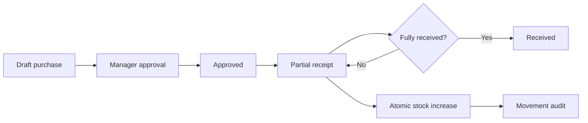
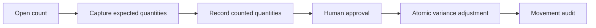
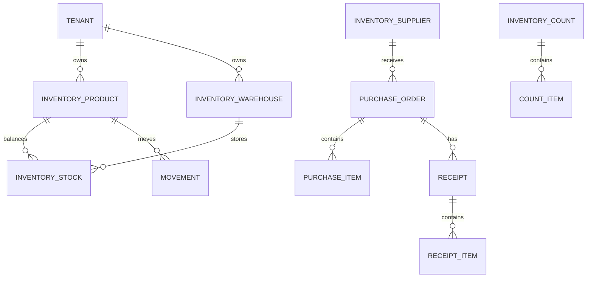

# Inventory flows and data model

## Purchase and receipt flow

AI-created or AI-suggested purchases remain in `draft` and require a separate approval call. The agent cannot skip the approval operation by changing the client payload.

## Inventory count flow

## ER overview

